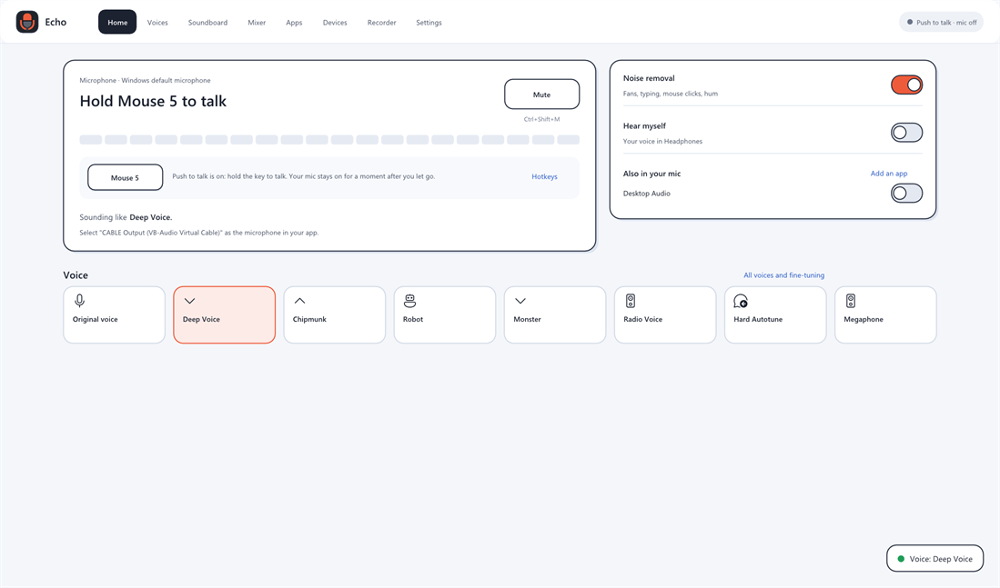
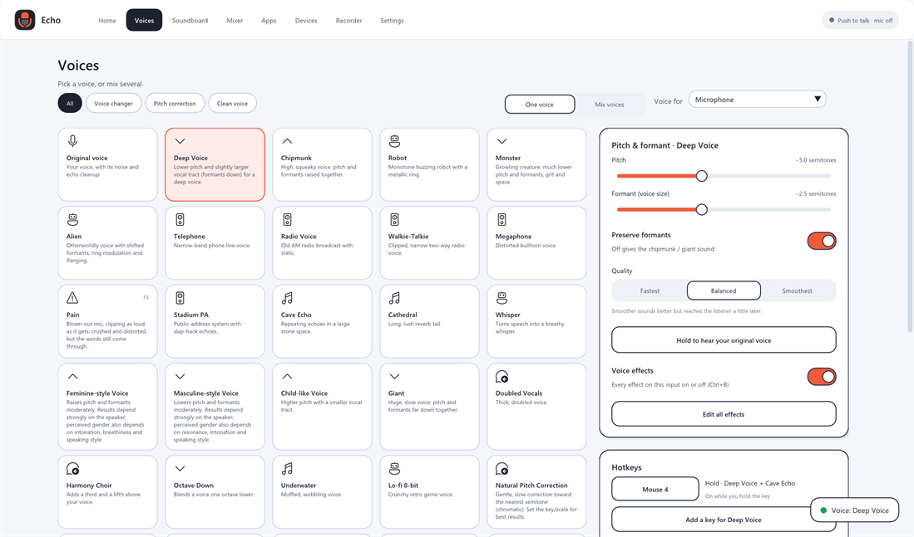
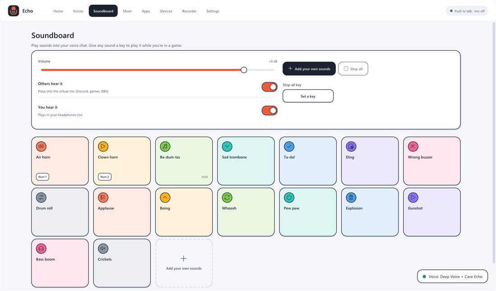

#  Echo

A free, open-source Windows 10/11 virtual audio mixer and real-time voice changer:
multichannel mixing and routing, per-application capture, a 30-effect DSP library,
neural background-noise suppression (on by default for microphones) and echo cancellation,
pitch/formant voice changing, pitch correction ("autotune"), a soundboard, recording, and
optional AI voices (RVC models, run on your PC). No accounts, subscriptions, ads or telemetry;
Echo goes online only when you click Install VB-CABLE, Install the AI engine, Download
ContentVec (the speech model RVC voices need) or Check for updates.



| Voices | Soundboard |
|---|---|
|  |  |

## Download

Get `Echo-<version>-setup-win64.exe` (or the portable zip) from the
[Releases](../../releases) page. `SHA256SUMS.txt` next to them lists their checksums.

Echo isn't code-signed yet, so Windows warns before the first start:

* **"Windows protected your PC"** (SmartScreen): click **More info**, then **Run anyway**.
* **Smart App Control** (Windows Security > App & browser control), when it is on, blocks
  apps that aren't signed and offers no way to allow them. Echo then only runs with Smart
  App Control turned off; check what that means for your PC before you do it.

## Updating

Settings > About > **Check for updates** asks GitHub for a newer release (only when you click).
If there is one, **Download and install** gets the installer from the release, checks it against
the release's `SHA256SUMS.txt`, closes Echo, updates it and starts it again; your settings stay.
A portable or self-built copy can't update itself and opens the release page instead.

## Quick start

1. Install: run `Echo-<version>-setup-win64.exe` (per user, no admin), or unzip the portable build.
2. Start Echo; the setup guide picks your microphone and headphones.
3. **Virtual microphone for Discord, Roblox, OBS and games** needs a virtual audio cable driver.
   The setup guide's **Install VB-CABLE** button downloads VB-Audio's free installer and opens it
   (or get it from vb-audio.com). Then in the app choose `CABLE Output` as the microphone (input)
   and keep your headphones as its speakers (output); leave Windows' own sound settings as they
   are. See `docs/VIRTUAL_DEVICES.md`.
4. **Home**: mute, push to talk status, noise removal, hearing yourself and quick voices.
   **Voices**: one-click voices (deep, chipmunk, robot, monster, radio, ...), pitch and pitch
   correction, noise removal, voice gate, echo cancellation, and AI voices (add an RVC voice,
   click **Install the AI engine**; see `docs/AI_VOICE.md`). **Soundboard**: 16 built-in
   sounds plus your own, with hotkeys. **Mixer**, **Apps**, **Devices**, **Recorder** and
   **Settings** (including push-to-talk and mute hotkeys) are the other screens.

## Build

```powershell
winget install --id MartinStorsjo.LLVM-MinGW.UCRT --scope user
python -m pip install --user cmake ninja
./build.ps1 -Test          # Release build + automated tests
./build.ps1 -Package       # + portable ZIP and installer
```

## Documentation

* `docs/FEATURES.md` — what works and how it was verified (tested / hardware-verified / blocked)
* `docs/ARCHITECTURE.md` — design decisions, real-time model, clocking, AI pipeline
* `docs/BUILDING.md`, `docs/TESTING.md`, `docs/TROUBLESHOOTING.md`
* `docs/VIRTUAL_DEVICES.md`, `docs/AI_VOICE.md`, `docs/FILE_FORMATS.md`

## Code signing policy

Release files are built from this repository by GitHub Actions
(`.github/workflows/build.yml`: build, tests, installer and checksums), not on a
personal computer. They are not code-signed yet.

* Committers and reviewers: [Xach-A](https://github.com/Xach-A)
* Approvers: [Xach-A](https://github.com/Xach-A)

Privacy: this program will not transfer any information to other networked systems unless
specifically requested by the user or the person installing or operating it (Echo goes online
only for its download buttons and Check for updates).

## License

MIT (see `LICENSE`). Third-party components: `THIRD_PARTY_NOTICES.md`.
